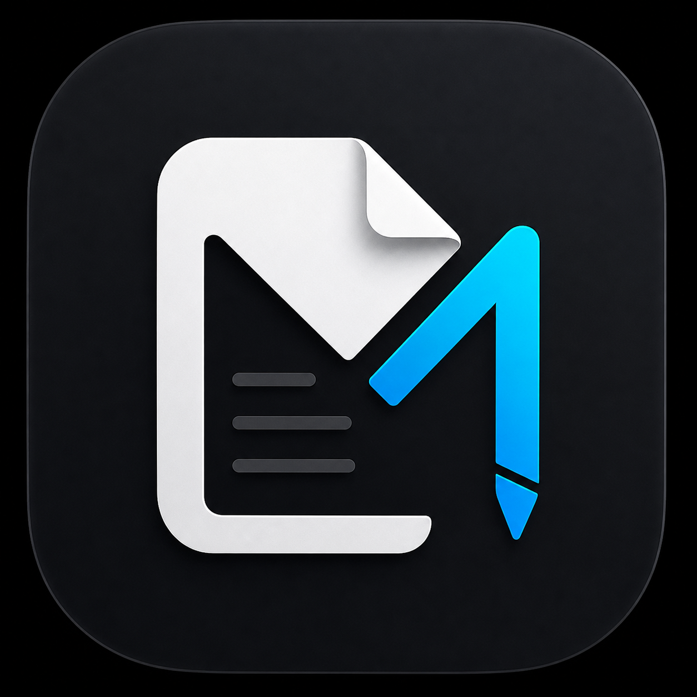
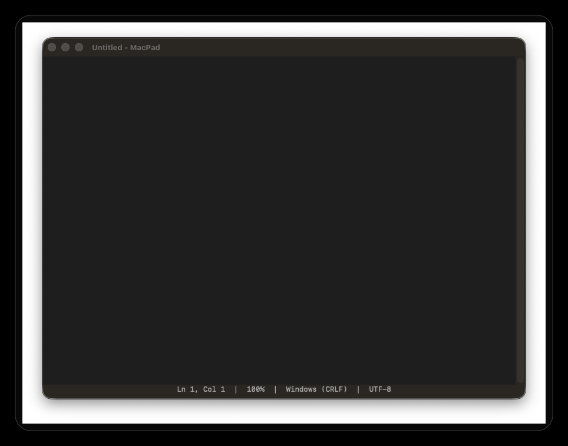

<h1>
  MacPad
  
</h1>

[](https://github.com/anvilfilbert/MacPad/releases/latest)
[](https://github.com/anvilfilbert/MacPad/actions/workflows/swift-ci.yml)
[](LICENSE)
[](Package.swift)

Ultra-fast native plain-text editor for macOS. No bloat.

## MacPad family

- [MacPad family website](https://macpad.net/) presents both apps.
- MacPad is the native macOS editor in this repository.
- [MacPad Mobile](https://macpad.net) is the native
  iPhone and iPad counterpart.

The apps are separate codebases and do not automatically synchronize open
documents, tabs, settings, or recovery data. Files stored in a shared location
can be opened explicitly from either app.

[](https://deepwiki.com/anvilfilbert/MacPad)

<p align="center">
  
</p>

## Download

Download the latest ready-to-use universal app for Apple silicon and Intel Macs
running macOS 14 or later:

[Download the latest MacPad release](https://github.com/anvilfilbert/MacPad/releases/latest)

For a DMG, open the disk image and drag `MacPad.app` to Applications. For a legacy
ZIP, unzip it and drag `MacPad.app` to Applications. Quit an existing copy before
replacing it. The release page provides the matching checksum and release notes.

GitHub is the canonical download source. The [SourceForge mirror](https://sourceforge.net/projects/macpad-editor/files/latest/download)
may offer an older release; do not assume it contains the newest GitHub artifact.

The legacy 1.3.1 ZIP is ad-hoc-signed, not Apple-notarized. Its matching `.sha256`
and GitHub build-provenance attestation do not change that signing status.

## Latest Changes

See the [latest release notes](https://github.com/anvilfilbert/MacPad/releases/latest)
for the published version and [CHANGELOG.md](CHANGELOG.md) for development and
release history.

## Distribution status

MacPad for macOS will continue as a direct download, following an unsuccessful
Mac App Store appeal. MacPad Mobile remains independently available through the
App Store. Public Mac testing is closed.

Branded direct-distribution DMGs must pass Developer ID signing, notarization,
stapling, Gatekeeper, installation, and launch checks before publication. Only
files listed on the release page are available to download; preparation in this
repository is not a published release. Version tags do not automatically publish ZIPs.

See [App Store preparation](docs/app-store-preparation.md) for the dated
distribution evidence, English/German metadata drafts, and remaining gates.

## Features

- Plain-text editing with native undo, cut, copy, paste, delete, and select all
- New Document, New Tab, New Window, open, Open Recent, save, save as, and print
- Multiple windows, each with multiple tabs
- New Document opens in the active tab group when one exists; New Window always stays separate
- Optional OFF-by-default menu-bar launcher for opening a new empty window with one click
- Every normal launch opens one new blank document; saved files remain available through Open Recent instead of reopening automatically
- Unsaved-change prompts when closing or quitting
- A native Find submenu with find, find next/previous, replace, and replace all controls using Match Case and Wrap Around options
- Standard shortcuts including `Command-N` for a new document, `Command-T` for a new tab, and `Option-Command-F` for Replace
- Go to line and insert current time/date
- Word wrap toggle
- App-wide persistent font chooser and per-tab zoom controls
- VoiceOver labels, stable accessibility identifiers, and predictable keyboard focus order
- Status bar showing line, column, zoom, line ending mode, and detected file encoding
- UTF-8, UTF-8 BOM, UTF-16 LE/BE, Windows-1252, and ISO-8859-1 detection, preservation, and Save As conversion
- Windows, Unix, classic Mac, and mixed line-ending detection and preservation
- Builds into a launchable universal `MacPad.app`
- Uses the included MacPad logo as the app icon

## Build

```sh
./scripts/build-app.sh
```

The app bundle is created at:

```text
build/MacPad.app
```

Launch it from Finder or with:

```sh
open build/MacPad.app
```

Install it into `/Applications` with:

```sh
./scripts/install-app.sh
```

Create an ad-hoc-signed development ZIP with:

```sh
./scripts/package-release.sh
```

For the separately authorized Developer ID DMG release, use the project-local
environment and commands documented in `scripts/notarize-dmg.py`. The owner must
provide an existing signing identity and notarytool Keychain profile. Do not
publish the unsigned preview produced by `scripts/package-dmg.py`.

Run the automated suite with:

```sh
swift test
```

## Community

- Use [MacPad Support](https://macpad.net/support) for help and usage details.
- Use [Discussions](https://github.com/anvilfilbert/MacPad/discussions) for questions and ideas.
- Open an [issue](https://github.com/anvilfilbert/MacPad/issues/new/choose) for a reproducible bug or focused feature request.
- See [CONTRIBUTING.md](CONTRIBUTING.md) before submitting a pull request.

## License

MacPad is available under the [Apache License 2.0](LICENSE).

## Security

Report vulnerabilities through [GitHub private vulnerability reporting](https://github.com/anvilfilbert/MacPad/security/advisories/new). See [SECURITY.md](SECURITY.md) for policy details.
